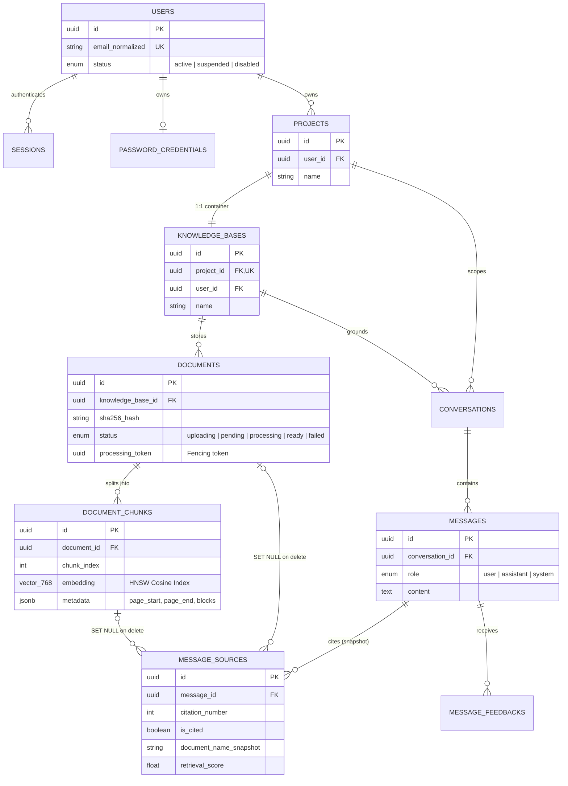
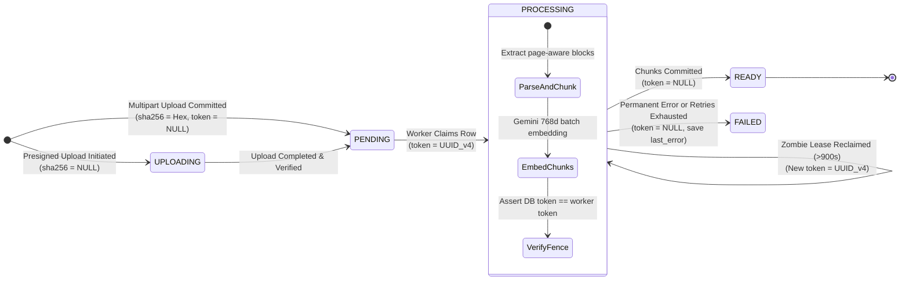
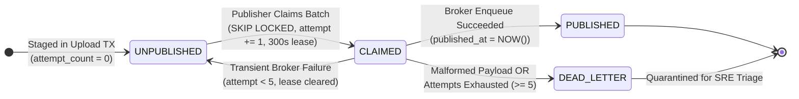
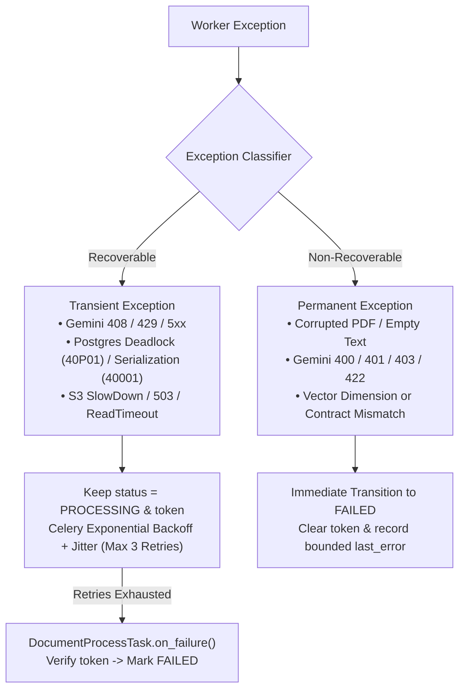
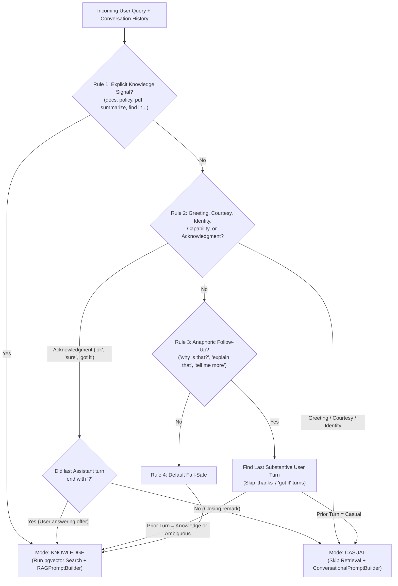
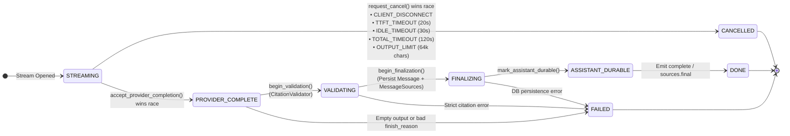

# Basic RAG Service

[](https://www.python.org/downloads/)
[](https://fastapi.tiangolo.com)
[](https://github.com/pgvector/pgvector)
[](https://docs.celeryq.dev/)
[](https://github.com/astral-sh/ruff)
[](https://github.com/detachhead/basedpyright)

**Basic RAG Service** is a production-grade, multi-tenant Retrieval-Augmented Generation (RAG) backend built with **FastAPI**, **PostgreSQL (`pgvector`)**, **Celery**, **Redis**, **S3/Local Storage**, and **Google Gemini**.

Most RAG prototypes fail under real traffic because they block HTTP threads on slow embedding calls, lose background tasks when a broker hiccups (dual-write bugs), or leak connections when LLM streams stall. This service is engineered around **transactional durability, explicit concurrency control, and strict grounding invariants**:

- **Zero-Blocking Uploads (<25ms):** Document uploads never wait on AI calls. The API validates the file, stores it by content hash, and commits the `Document` and `OutboxEvent` rows in a single ACID transaction.
- **Split-Brain & Poison-Pill Protection:** Ingestion workers claim documents using **Kleppmann Fencing Tokens (`processing_token`)** so a stalled worker can never overwrite newer chunks, while a **Dead-Letter Queue (DLQ)** isolates malformed payloads.
- **Sub-Millisecond Query Routing & Prompt Defense:** A deterministic `QueryRouter` bypasses vector search on casual turns (`<1ms`), `RAGPromptBuilder` isolates untrusted document chunks inside `<retrieved_context>` tags, and `CitationValidator` audits every `[N]` reference against the active context window.
- **Cooperative SSE & AG-UI Streaming:** Real-time token streams enforce first-token (`20s`), idle (`30s`), and total (`120s`) watchdogs with `15s` heartbeat pings—persisting the assistant turn only after full stream completion.

---

## Table of Contents

1. [System Architecture](#1-system-architecture)
   - [Write Path: Asynchronous Ingestion Pipeline](#11-write-path-asynchronous-ingestion-pipeline)
   - [Read Path: Real-Time Retrieval & Streaming Chat](#12-read-path-real-time-retrieval--streaming-chat)
   - [Multi-Tenant Data Model (ER Diagram)](#13-multi-tenant-data-model-er-diagram)
2. [Key Engineering Highlights](#2-key-engineering-highlights)
3. [Document Ingestion & Outbox Lifecycle](#3-document-ingestion--outbox-lifecycle)
   - [End-to-End Ingestion Sequence](#31-end-to-end-ingestion-sequence)
   - [Document State Machine & Fencing Invariants](#32-document-state-machine--fencing-invariants)
   - [Transactional Outbox & Dead-Letter Queue (DLQ)](#33-transactional-outbox--dead-letter-queue-dlq)
   - [Error Classification & Retry Policy](#34-error-classification--retry-policy)
4. [Retrieval, Routing & Streaming Engine](#4-retrieval-routing--streaming-engine)
   - [Deterministic Query Routing](#41-deterministic-query-routing)
   - [Context Budgeting, Semantic Authority & Citation Auditing](#42-context-budgeting-semantic-authority--citation-auditing)
   - [Cooperative Streaming Lifecycle & Watchdogs](#43-cooperative-streaming-lifecycle--watchdogs)
   - [Cryptographic Cursor Pagination (v2 API)](#44-cryptographic-cursor-pagination-v2-api)
5. [Repository Structure](#5-repository-structure)
6. [Tech Stack](#6-tech-stack)
7. [API Reference](#7-api-reference)
8. [Local Development Setup](#8-local-development-setup)
9. [Operations & SRE Runbook](#9-operations--sre-runbook)

---

## 1. System Architecture

To keep failure domains isolated, the architecture separates the **Asynchronous Ingestion Pipeline (Write Path)** from the **Real-Time Retrieval & Chat Engine (Read Path)**.

### 1.1 Write Path: Asynchronous Ingestion Pipeline

```mermaid
flowchart LR
    classDef client fill:#1e293b,stroke:#38bdf8,stroke-width:2px,color:#f8fafc;
    classDef api fill:#1e1e2e,stroke:#a855f7,stroke-width:2px,color:#f8fafc;
    classDef db fill:#0f172a,stroke:#10b981,stroke-width:2px,color:#f8fafc;
    classDef worker fill:#1c1917,stroke:#f59e0b,stroke-width:2px,color:#f8fafc;
    classDef ai fill:#1f2937,stroke:#ec4899,stroke-width:2px,color:#f8fafc;

    Client(["Client / SDK"]) -->|"1. POST /documents"| Upload["FastAPI Upload Service<br/>(Validate & SHA-256 Hash)"]
    Upload -->|"2. Save kb_id/sha256.pdf"| Storage[("Object Storage<br/>(S3 / Tigris / Local FS)")]
    Upload -->|"3. Single ACID TX"| PG[("PostgreSQL 16<br/>documents + outbox_events")]
    Upload -.->|"4. 201 Created (<25ms)"| Client

    Beat["Celery Beat<br/>(5s Ticker)"] -->|"5. Poll SKIP LOCKED"| OutboxPub["Outbox Publisher<br/>(300s Lease Claim)"]
    PG <-->|"Claim & Mark Published"| OutboxPub
    OutboxPub -->|"6. Enqueue document_id"| Redis[("Redis Broker<br/>(documents queue)")]
    OutboxPub -.->|"Poison Pill / >=5 Attempts"| DLQ[("Dead-Letter<br/>Quarantine")]

    Redis -->|"7. Consume Task"| Ingest["Ingestion Worker<br/>(Fenced by processing_token)"]
    Storage -->|"8. Read & Parse PDF Blocks"| Ingest
    Ingest <-->|"9. Batch Embed (768d)"| GeminiEmbed["Google Gemini<br/>(gemini-embedding-001)"]
    Ingest -->|"10. Verify Token & Commit"| Chunks[("PostgreSQL pgvector<br/>document_chunks (HNSW)")]

    class Client client;
    class Upload api;
    class Storage,PG,Chunks,DLQ db;
    class Beat,OutboxPub,Redis,Ingest worker;
    class GeminiEmbed ai;
```



### 1.2 Read Path: Real-Time Retrieval & Streaming Chat

```mermaid
flowchart LR
    classDef client fill:#1e293b,stroke:#38bdf8,stroke-width:2px,color:#f8fafc;
    classDef api fill:#1e1e2e,stroke:#a855f7,stroke-width:2px,color:#f8fafc;
    classDef db fill:#0f172a,stroke:#10b981,stroke-width:2px,color:#f8fafc;
    classDef ai fill:#1f2937,stroke:#ec4899,stroke-width:2px,color:#f8fafc;

    User(["SSE / AG-UI Client"]) -->|"1. POST /messages/stream"| Prep["Prepare Turn<br/>(Persist User Msg & Load History)"]
    Prep -->|"Release DB Lock"| Router{"QueryRouter<br/>(&lt;1ms Regex Gate)"}

    Router -->|"CASUAL<br/>(Greeting / Courtesy / Ack)"| ConvPrompt["ConversationalPromptBuilder<br/>(Clean History, No Context)"]
    Router -->|"KNOWLEDGE<br/>(Domain Query / Follow-up)"| EmbedQuery["Embed Query<br/>(gemini-embedding-001)"]

    EmbedQuery -->|"2. 768d Vector"| VectorDB[("pgvector HNSW Search<br/>(READY docs only)")]
    VectorDB -->|"3. Top-K Chunks"| Assembler["ContextAssembler<br/>(Deduplicate & Budget 16k Chars)"]
    Assembler -->|"4. <retrieved_context>"| RAGPrompt["RAGPromptBuilder<br/>(Semantic Authority Model)"]

    ConvPrompt --> StreamLLM["Gemini Chat Model<br/>(Streaming Inference)"]
    RAGPrompt --> StreamLLM

    StreamLLM -->|"5. Token Deltas + 15s Ping"| Watchdog["Stream Lifecycle & Watchdogs<br/>(20s TTFT / 30s Idle / 120s Total)"]
    Watchdog -->|"6. SSE / AG-UI Frames"| User
    Watchdog -->|"7. Audit Citations & Commit"| History[("PostgreSQL<br/>messages + message_sources")]

    class User client;
    class Prep,Router,ConvPrompt,EmbedQuery,Assembler,RAGPrompt,Watchdog api;
    class VectorDB,History db;
    class StreamLLM ai;
```



### 1.3 Multi-Tenant Data Model (ER Diagram)

Tenant isolation is enforced down to the PostgreSQL schema via **composite foreign keys** (`projects -> knowledge_bases -> conversations`). Deleting a document sets `message_sources.document_id` to `NULL` while preserving historical citation snapshots (`document_name_snapshot`, `page_start_snapshot`).



---

## 2. Key Engineering Highlights

| Capability                                 | The Problem It Solves                                                                                                                                         | How It Is Engineered Here                                                                                                                                                                        |
| :----------------------------------------- | :------------------------------------------------------------------------------------------------------------------------------------------------------------ | :----------------------------------------------------------------------------------------------------------------------------------------------------------------------------------------------- |
| **Transactional Outbox Pattern**           | **Dual-Write Bugs:** Writing to Postgres and publishing to Redis in one HTTP request is not atomic; broker hiccups silently drop ingestion jobs.              | `Document` creation and `OutboxEvent` insertion happen in the **same ACID transaction**. A background publisher relays events to Redis safely.                                                   |
| **Kleppmann Fencing Tokens**               | **Split-Brain Worker Writes:** A worker paused by GC or network lag can wake up after its lease expires and overwrite chunks created by a newer retry worker. | Every worker claim assigns a unique `UUID_v4` `processing_token`. Before writing chunks, the worker locks the document row and verifies its token still matches.                                 |
| **DB Connection Pool Discipline**          | **Idle-in-Transaction Exhaustion:** Holding a database transaction open while waiting on slow Gemini embedding or chat APIs starves the connection pool.      | Both `RetrievalService` and `ChatService.prepare_turn` explicitly call `db.rollback()` after fast ownership/history reads **before** any external AI network I/O begins.                         |
| **Lock-Free Queue Polling**                | **Row Lock Contention:** Naive database polling causes multiple worker processes to block on the same locked rows.                                            | Outbox and session cleanup queries use `SELECT ... FOR UPDATE SKIP LOCKED`, allowing workers to skip locked rows without blocking.                                                               |
| **Poison-Pill Quarantine (DLQ)**           | **Infinite Retry Loops:** Corrupted payloads or permanent broker failures cause endless retries that starve healthy tasks.                                    | Invalid outbox payloads transition immediately to `DEAD_LETTER` (`MALFORMED_PAYLOAD`), and broker failures quarantine after 5 attempts (`EXHAUSTED_PUBLICATION_ATTEMPTS`).                       |
| **Deterministic Query Routing**            | **Wasted Retrieval & Latency:** Running vector search on _"Hi"_, _"Got it, thanks"_, or _"Who are you?"_ wastes embedding calls and clutters prompts.         | `QueryRouter` evaluates word-bounded regexes in `<1ms`, routing conversational turns to `CASUAL` (zero retrieval) while failing safe to `KNOWLEDGE` whenever a question is pending or ambiguous. |
| **Semantic Authority & Citation Auditing** | **Prompt Injection & Fake Citations:** Adversarial instructions inside PDFs can hijack the LLM, or the model can cite non-existent sources like `[99]`.       | Retrieved chunks are isolated inside `<retrieved_context>` data envelopes, character-budgeted end-to-end, and audited by `CitationValidator`.                                                    |
| **HMAC-Signed Cursor Pagination**          | **Offset Drift & Tampering:** `LIMIT/OFFSET` degrades to $O(N)$ scans on deep histories and shifts items as new messages arrive.                              | `/api/v2` endpoints use stateless **HMAC-SHA256** keyset cursors bound to the resource scope, with zero-downtime dual-key rotation (`CURSOR_PREVIOUS_SIGNING_KEY`).                              |

---

## 3. Document Ingestion & Outbox Lifecycle

### 3.1 End-to-End Ingestion Sequence

```mermaid
sequenceDiagram
    autonumber
    actor Client
    participant API as FastAPI Gateway
    participant Storage as Object Storage (S3/Local)
    participant DB as PostgreSQL (ACID + pgvector)
    participant Pub as Outbox Publisher
    participant Redis as Redis Broker
    participant Worker as Ingestion Worker
    participant Gemini as Google Gemini API

    rect rgb(28, 41, 56)
    Note over Client,DB: Phase 1: Fast Synchronous Upload (<25ms, Zero AI Blocking)
    Client->>API: POST /api/v1/knowledge-bases/{kb_id}/documents
    API->>API: Validate extension, size & compute SHA-256 hash
    API->>Storage: Save raw file to kb_id/sha256.ext
    API->>DB: BEGIN TX: Insert Document (PENDING, token=NULL) + Insert OutboxEvent
    DB-->>API: COMMIT TX
    API-->>Client: 201 Created (document_id, status=PENDING)
    end

    rect rgb(35, 30, 24)
    Note over DB,Redis: Phase 2: Outbox Relay Loop (Every 5s)
    Pub->>DB: Sweep stale exhausted claims -> DEAD_LETTER
    Pub->>DB: Claim batch (FOR UPDATE SKIP LOCKED, claim_token=UUID)
    Pub->>Redis: Enqueue document.process(document_id)
    Pub->>DB: Set published_at = NOW() WHERE claim_token matches
    end

    rect rgb(30, 25, 45)
    Note over Redis,Gemini: Phase 3: Fenced Ingestion & Vector Indexing
    Redis->>Worker: Deliver document.process(document_id)
    Worker->>DB: Lock row & set status=PROCESSING, processing_token=UUID_v4
    Worker->>Storage: Read raw document bytes
    Worker->>Worker: Parse PDF blocks, normalize & split (DocumentAwareChunker)
    Worker->>Gemini: Batch embed chunks (gemini-embedding-001, 768d)
    Gemini-->>Worker: Return 768-dim vectors
    Worker->>DB: SELECT FOR UPDATE: Verify processing_token == UUID_v4
    alt Token Matches (Valid Lease)
        Worker->>DB: Replace document_chunks + Set status=READY, processing_token=NULL
        DB-->>Worker: COMMIT TX
    else Token Superseded (Another worker reclaimed stale lease)
        Worker->>Worker: Abort & Rollback (Split-brain write prevented)
    end
    end
```



### 3.2 Document State Machine & Fencing Invariants



- **Database Check Constraint (`ck_documents_uploading_hash_state`):** Enforces at the PostgreSQL level that `sha256_hash IS NULL` if and only if `status = 'uploading'`.
- **Zombie Lease Recovery:** If a worker container crashes mid-flight (`status = 'processing'` and `last_error IS NULL`) and exceeds `document_processing_timeout_seconds` (`900s`), a subsequent task reclaims the document with a fresh `processing_token`, fencing out the dead worker.

### 3.3 Transactional Outbox & Dead-Letter Queue (DLQ)



Before claiming new work on each 5-second tick, `publish_outbox_events` sweeps any stale final-attempt claims whose worker crashed during its lease (`EXHAUSTED_RETRIES_LEASE_EXPIRED`) so no event ever silently disappears.

### 3.4 Error Classification & Retry Policy

Exceptions across AI providers (`app/core/ai/classification.py`), PostgreSQL (`app/db/classification.py`), and Storage (`app/core/storage/`) are deterministically classified:



---

## 4. Retrieval, Routing & Streaming Engine

### 4.1 Deterministic Query Routing

Running embeddings and vector search on every conversational turn wastes money and latency. `QueryRouter` evaluates incoming turns in `<1ms` using a 4-rule priority cascade:



### 4.2 Context Budgeting, Semantic Authority & Citation Auditing

1. **Block-Aware Chunking (`DocumentAwareChunker`):** Preserves paragraph and list boundaries from `PDFParser` while accumulating blocks up to `chunk_size` (`1000` chars) and splitting oversized blocks with `RecursiveCharacterTextSplitter` (`200` char overlap), recording `source_block_indexes`, `page_start`, and `page_end`.
2. **Complete-Block Budgeting (`ContextAssembler`):**
   - Deduplicates retrieved chunks by `(document_id, chunk_index)`, keeping the highest similarity score.
   - Enforces `chat_context_max_characters` (`16,000` chars) across the **entire rendered string** (including `[Source N] Document: "..."` headers and separators).
   - Escapes `</retrieved_context>` sequences inside chunk text so document content can never break out of the XML context envelope.
3. **Tolerant Citation Validation (`CitationValidator`):**
   - Validates single citations (`[1]`), expands comma/semicolon lists (`[1, 2]`, `[1; 2]`), and expands bounded ranges (`[1-3]`) while tracking `format_deviations`.
   - Ignores fenced/inline code blocks, Markdown links (`[text](url)`), and array subscripts (`matrix[1, 2]`).
   - Persists all retrieved chunks in `message_sources` with `is_cited=True/False` so UI clients render only verified, cited sources.

### 4.3 Cooperative Streaming Lifecycle & Watchdogs

`ChatStreamLifecycle` coordinates thread-safe state transitions between the async FastAPI event loop (which monitors client disconnects and timeouts) and the worker thread consuming the Gemini stream:



### 4.4 Cryptographic Cursor Pagination (v2 API)

All `/api/v2` listing endpoints replace `OFFSET` pagination with stateless, scope-bound cursors signed with **HMAC-SHA256**:

$$\text{Cursor} = \text{Base64Url}\Big(\text{JSON}(\{v, kid, r, s, sort, c, i, w\})\Big) \;\Vert\; \text{"."} \;\Vert\; \text{Base64Url}\Big(\text{HMAC-SHA256}_{\text{key}}(\text{Payload})\Big)$$

- **Snapshot Isolation (`w`):** Encodes the initial page's `snapshot_timestamp` so newly created conversations or messages never shift items across page boundaries while scrolling.
- **Scope Binding (`r`, `s`):** Binds each cursor to its `CursorResource` (`conversations` or `messages`) and `scope_id` (`knowledge_base_id` or `conversation_id`).
- **Zero-Downtime Key Rotation:** Verifies signatures against `cursor_signing_key` first, falling back to `cursor_previous_signing_key`.

---

## 5. Repository Structure

```text
app/
├── api/
│   ├── router.py                  # v1 API router aggregator (/api/v1)
│   └── v2.py                      # v2 API router (signed cursor pagination & AG-UI)
├── core/
│   ├── ai/
│   │   ├── chunking/              # Block-aware DocumentAwareChunker
│   │   ├── context/               # ContextAssembler & CitationValidator
│   │   ├── embeddings/            # GeminiEmbeddingGenerator (768d validation)
│   │   ├── llm/                   # GeminiLLMProvider (sync & streaming adapters)
│   │   ├── prompting/             # RAGPromptBuilder & ConversationalPromptBuilder
│   │   ├── retrieval/             # ChunkProvenance, RetrievedChunk, Recall/Precision@K
│   │   └── routing/               # Deterministic QueryRouter (<1ms regex gate)
│   ├── auth/                      # Argon2id PasswordHasherService & SessionTokenService
│   ├── document/                  # PDFParser, DocumentNormalizer, UploadValidator, FileHasher
│   ├── storage/                   # S3ObjectStorage (Tigris/S3) & LocalFilesystemStorage
│   ├── config.py                  # Pydantic BaseSettings configuration
│   ├── exceptions.py              # Domain exception hierarchy & FastAPI error handlers
│   └── pagination.py              # HMAC-SHA256 CursorCodec
├── db/
│   ├── models/                    # SQLAlchemy 2.0 ORM models (User, Project, KB, Document, etc.)
│   ├── classification.py          # PostgreSQL SQLSTATE error classification (23505, 40P01, etc.)
│   └── session.py                 # Engine, SessionLocal, and managed_session context manager
├── dependencies/                  # FastAPI Annotated Dependency Injection wiring
├── modules/
│   ├── auth/                      # Register, login, logout, session activity tracking
│   ├── projects/                  # Multi-tenant Project + 1:1 KnowledgeBase lifecycle
│   ├── document/                  # Upload service & fenced DocumentIngestionService
│   ├── retrieval/                 # Semantic vector search controller & service
│   ├── conversations/             # Conversation management, v2 cursor pages & message feedback
│   └── chat/                      # Sync/stream chat orchestration & AG-UI protocol adapter
├── repositories/                  # Data access layer (SQLAlchemy 2.0 typed queries)
├── worker/
│   ├── celery_app.py              # Celery configuration, queues & Beat schedule
│   └── tasks/                     # document_tasks.py, outbox_tasks.py, session_tasks.py
└── main.py                        # FastAPI application entrypoint
```

---

## 6. Tech Stack

| Layer                   | Technology                 | Configuration                                     | Purpose                                                                             |
| :---------------------- | :------------------------- | :------------------------------------------------ | :---------------------------------------------------------------------------------- |
| **Runtime**             | Python                     | `>= 3.14`                                         | Modern type system (`type` aliases, PEP 695 generics) and high performance.         |
| **Web Framework**       | FastAPI + Uvicorn          | `0.140+`                                          | Async request handling, dependency injection, and OpenAPI schema generation.        |
| **Database & ORM**      | PostgreSQL 16 + SQLAlchemy | `2.0+` (`psycopg3`)                               | ACID transactions, composite FKs, `FOR UPDATE SKIP LOCKED`, and JSONB metadata.     |
| **Vector Search**       | `pgvector`                 | `0.5.0+` (HNSW)                                   | 768-dim cosine similarity index (`vector_cosine_ops`).                              |
| **Task Queue**          | Celery + Redis             | Celery `5.6+`, Redis `8.1+`                       | Dedicated `documents` and `maintenance` queues with Beat scheduling.                |
| **AI Provider**         | Google Gemini              | `gemini-embedding-001`<br>`gemini-3.5-flash-lite` | 768-dim embeddings and low-latency streaming chat completions.                      |
| **Object Storage**      | S3 / Tigris / Local FS     | `boto3` (`s3v4`)                                  | Pluggable storage backend supporting content-addressed keys & presigned URLs.       |
| **Authentication**      | Argon2id + SHA-256 Cookies | `argon2-cffi`                                     | Memory-hard password hashing and revocable server-side sessions with idle timeouts. |
| **Streaming Protocols** | SSE + AG-UI                | `sse-starlette`, `ag-ui`                          | Supports both v1 custom SSE events and v2 AG-UI standard streaming frames.          |

---

## 7. API Reference

### 7.1 Authentication (`/api/v1/auth`)

| Method | Endpoint                  | Description                                         | Status           |
| :----- | :------------------------ | :-------------------------------------------------- | :--------------- |
| `POST` | `/api/v1/auth/register`   | Register a new user with Argon2id password hashing  | `201 Created`    |
| `POST` | `/api/v1/auth/login`      | Authenticate user and set `HttpOnly` session cookie | `200 OK`         |
| `GET`  | `/api/v1/auth/me`         | Retrieve current authenticated user profile         | `200 OK`         |
| `POST` | `/api/v1/auth/logout`     | Revoke current session and clear cookie             | `204 No Content` |
| `POST` | `/api/v1/auth/logout-all` | Revoke all active sessions for current user         | `204 No Content` |

### 7.2 Projects, Documents & Retrieval (`/api/v1`)

| Method   | Endpoint                                    | Description                                          | Status           |
| :------- | :------------------------------------------ | :--------------------------------------------------- | :--------------- |
| `POST`   | `/api/v1/projects`                          | Create a project and its backing knowledge base      | `201 Created`    |
| `GET`    | `/api/v1/projects`                          | List user's projects                                 | `200 OK`         |
| `GET`    | `/api/v1/projects/{project_id}`             | Fetch project details and `knowledge_base_id`        | `200 OK`         |
| `PATCH`  | `/api/v1/projects/{project_id}`             | Update project name or description                   | `200 OK`         |
| `DELETE` | `/api/v1/projects/{project_id}`             | Delete project and cascade knowledge base & chats    | `204 No Content` |
| `POST`   | `/api/v1/knowledge-bases/{kb_id}/documents` | Upload a document and stage async outbox ingestion   | `201 Created`    |
| `GET`    | `/api/v1/knowledge-bases/{kb_id}/documents` | List documents and their processing status in a KB   | `200 OK`         |
| `POST`   | `/api/v1/knowledge-bases/{kb_id}/search`    | Run top-K semantic vector search across `READY` docs | `200 OK`         |

### 7.3 Conversations, Chat & Feedback (`/api/v1` & `/api/v2`)

| Method   | Endpoint                                        | Description                                             | Status           | Notes                                                        |
| :------- | :---------------------------------------------- | :------------------------------------------------------ | :--------------- | :----------------------------------------------------------- |
| `POST`   | `/api/v1/projects/{project_id}/conversations`   | Create a conversation scoped to a project               | `201 Created`    | —                                                            |
| `POST`   | `/api/v1/knowledge-bases/{kb_id}/conversations` | Create a conversation scoped to a knowledge base        | `201 Created`    | —                                                            |
| `GET`    | `/api/v1/conversations/{id}`                    | Fetch conversation metadata                             | `200 OK`         | —                                                            |
| `DELETE` | `/api/v1/conversations/{id}`                    | Delete conversation and cascade messages                | `204 No Content` | —                                                            |
| `POST`   | `/api/v1/conversations/{id}/messages`           | Submit a synchronous RAG chat turn                      | `200 OK`         | —                                                            |
| `POST`   | `/api/v1/conversations/{id}/messages/stream`    | Stream a RAG chat turn via v1 SSE events                | `200 OK`         | SSE (`metadata`, `citations`, `token`, `complete`)           |
| `POST`   | `/api/v2/conversations/{id}/messages/stream`    | Stream a RAG chat turn via AG-UI protocol               | `200 OK`         | AG-UI SSE (`RUN_STARTED`, `TEXT_MESSAGE_*`, `sources.final`) |
| `GET`    | `/api/v2/knowledge-bases/{kb_id}/conversations` | List conversations using HMAC-signed cursors            | `200 OK`         | Replaces deprecated v1 offset route                          |
| `GET`    | `/api/v2/conversations/{id}/messages`           | List messages using HMAC-signed cursors                 | `200 OK`         | Replaces deprecated v1 offset route                          |
| `PUT`    | `/api/v2/messages/{message_id}/feedback`        | Upsert thumbs-up/down (`up` / `down`) on assistant turn | `200 OK`         | Concurrency-safe `ON CONFLICT DO UPDATE`                     |
| `DELETE` | `/api/v2/messages/{message_id}/feedback`        | Remove user feedback from an assistant message          | `204 No Content` | —                                                            |

---

## 8. Local Development Setup

### Prerequisites

- **Python 3.14+**
- **Docker & Docker Compose** (PostgreSQL 16 + `pgvector` and Redis 8)
- **`uv`** package manager (`curl -LsSf https://astral.sh/uv/install.sh | sh`)
- **Google Gemini API Key**

### Step 1: Clone & Configure Environment

```bash
git clone https://github.com/theeaashish/Outbox-RAG.git
cd Outbox-RAG

# Copy .env template, install dependencies, and start Postgres + Redis
make env
make sync
make docker-up
```

Configure `.env` (for local development without S3, set `STORAGE_BACKEND=local`):

```env
GOOGLE_API_KEY=your_gemini_api_key
STORAGE_BACKEND=local
UPLOAD_DIRECTORY=uploads
CURSOR_SIGNING_KEY=replace-with-32-byte-secret-key
```

### Step 2: Apply Database Migrations

```bash
make migrate
```

### Step 3: Start the Services

Run the API server, worker, and scheduler in separate terminals:

```bash
# Terminal 1: FastAPI Server (http://127.0.0.1:8000/docs)
make dev

# Terminal 2: Celery Worker (documents + maintenance queues)
uv run celery -A app.worker.celery_app:celery_app worker \
  --queues=documents,maintenance \
  --concurrency=2 \
  --loglevel=INFO

# Terminal 3: Celery Beat Scheduler (5s outbox publisher & 1h session cleanup)
uv run celery -A app.worker.celery_app:celery_app beat \
  --loglevel=INFO
```

### Step 4: Quality Gates & Test Suite

```bash
make format     # Format code with Ruff
make check      # Run Ruff linter + BasedPyright static type checker
make test-cov   # Run Pytest suite with coverage report
make verify     # Run full pre-commit verification pipeline
```

---

## 9. Operations & SRE Runbook

### 9.1 Triage Unpublished or Dead-Lettered Outbox Events

If uploaded documents remain in `PENDING`, inspect the outbox queue state:

```sql
SELECT
    event_type,
    COUNT(*) FILTER (WHERE dead_lettered_at IS NULL) AS active_backlog,
    COUNT(*) FILTER (WHERE dead_lettered_at IS NOT NULL) AS dead_lettered_count,
    MAX(attempt_count) AS max_attempts,
    MIN(created_at) FILTER (WHERE dead_lettered_at IS NULL) AS oldest_pending
FROM outbox_events
WHERE published_at IS NULL
GROUP BY event_type;
```

- **Remediation:** Verify `celery beat` is running and inspect active workers on the `maintenance` queue:
  ```bash
  uv run celery -A app.worker.celery_app:celery_app inspect active --queues=maintenance
  ```

### 9.2 Identify Stale `PROCESSING` Documents

Find documents whose ingestion worker crashed or stalled for more than 15 minutes (`900s`):

```sql
SELECT
    id,
    filename,
    knowledge_base_id,
    retry_count,
    processing_token,
    processing_started_at,
    last_error
FROM documents
WHERE status = 'processing'
  AND COALESCE(processing_started_at, updated_at) < NOW() - INTERVAL '15 minutes';
```

### 9.3 Inspect Recent Ingestion Failures

View the 20 most recent permanent document ingestion failures:

```sql
SELECT
    id,
    filename,
    retry_count,
    last_error,
    updated_at
FROM documents
WHERE status = 'failed'
ORDER BY updated_at DESC
LIMIT 20;
```

---

## License

Distributed under the MIT License. See `LICENSE` for more information.
